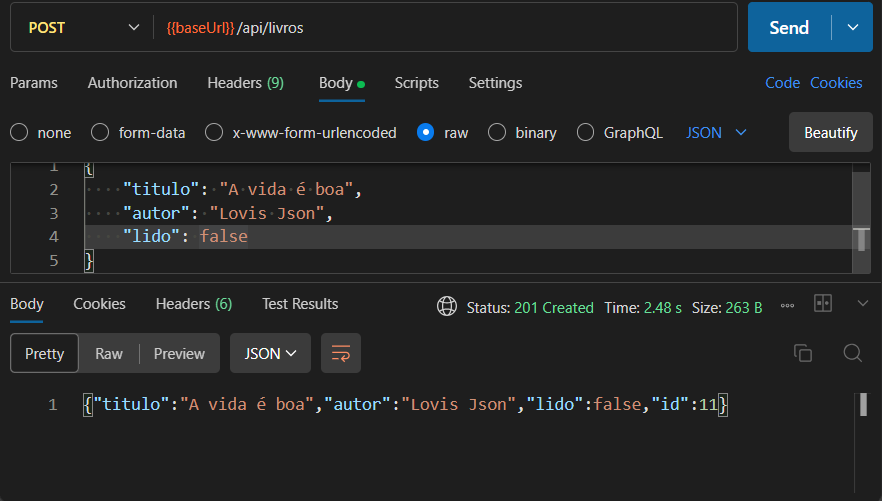
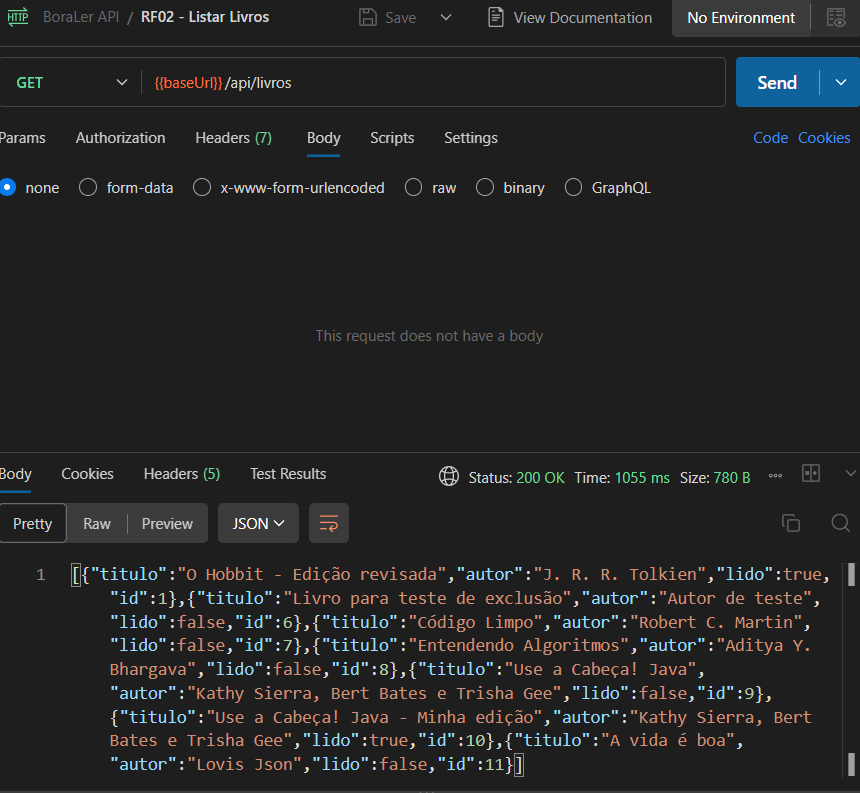
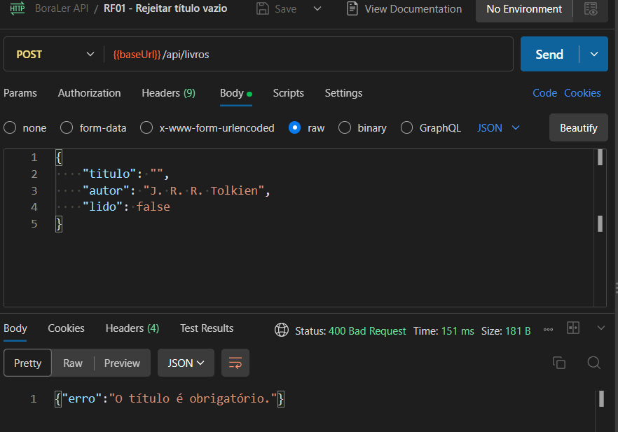
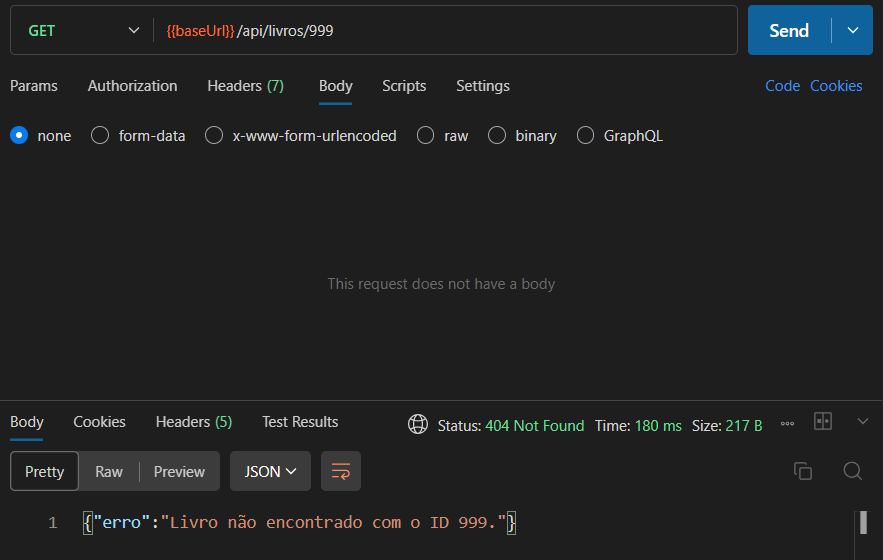
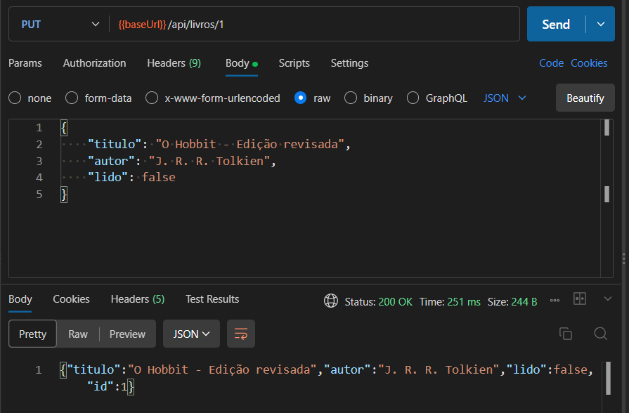
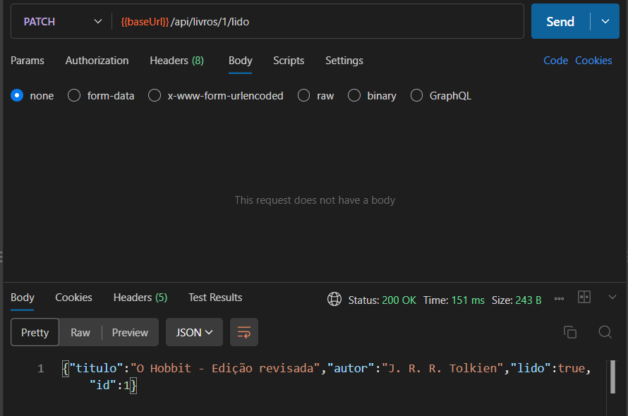
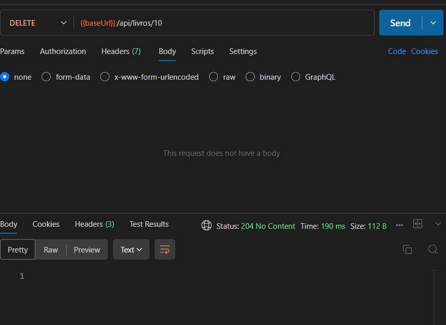
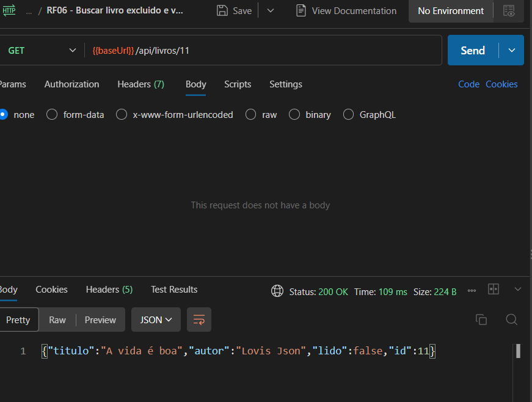

# BoraLer - API REST de livro

Projeto de conclusão do curso Jovem Programador, desenvolvido para gerenciar livros e acompanhar sua situação de leitura.

## Funcionalidades implementadas

- RF01 - Cadastrar livro.
- RF02 - Listar Livros.
- RF03 - Buscar livro pelo ID.
- RF04 - Atualizar livro.
- RF05 - Marcar livro como lido.
- RF06 - Excluir livro.

##Tecnologias

- Java 21
- Spring Boot 4.1.1
- Maven
- Spring Data JPA
- Bean Validation
- PostgreSQL no Neon
- Postman
- Git e GitHub

## Banco de dados

O projeto utiliza PostgreSQL hospedado no Neon em substituição
ao H2 em memória indicado no material do curso, com autorização
do professor.

Os dados permanecem armazenados após o encerramento da aplicação.
A conferência dos registros foi realizada pelo SQL Editor do Neon.

## Estado do projeto

Os seis requisitos funcionais da API estão implementados e foram verificados manualmente no Postman, com persistência no PostgreSQL hospedado no Neon.

A documentação e a preparação da entrega estão em andamento.

## Configuração e execução

Pré-requisito: JDK 21.

A aplicação utiliza estas variáveis de ambiente:

| Variável    | Conteúdo                                |
| ----------- | --------------------------------------- |
| DB_URL      | URL JDBC do PostgreSQL no Neon, com SSL |
| DB_USERNAME | Usuário do banco                        |
| DB_PASSWORD | Senha do banco                          |

A configuração principal lê DB_URL, DB_USERNAME e DB_PASSWORD das variáveis de ambiente.

Como alternativa para desenvolvimento local, crie o arquivo backend/src/main/resources/application-local.properties com:

```properties
spring.datasource.url=jdbc:postgresql://SEU_HOST/neondb?sslmode=require&channelBinding=require
spring.datasource.username=SEU_USUARIO
spring.datasource.password=SUA_SENHA
```

Substitua os valores de exemplo pelos dados da conexão Java/JDBC fornecidos pelo Neon.

O arquivo application-local.properties contém credenciais locais e deve permanecer ignorado pelo Git. Nunca envie esse arquivo ao GitHub.

### Executar com variáveis de ambiente

Com DB_URL, DB_USERNAME e DB_PASSWORD configuradas no mesmo
terminal, abra a pasta backend e execute:

```powershell
.\mvnw.cmd spring-boot:run
```

### Executar com configuração local

Se você criou o arquivo application-local.properties, abra
a pasta backend e execute com o perfil local:

```powershell
.\mvnw.cmd spring-boot:run "-Dspring-boot.run.profiles=local"
```

O servidor inicia na porta 8080.

A aplicação roda localmente e utiliza o banco hospedado no Neon.

## Endpoints

| Método | Endpoint              | Sucesso        | Erros previstos                                 |
| ------ | --------------------- | -------------- | ----------------------------------------------- |
| POST   | /api/livros           | 201 Created    | 400: dados inválidos                            |
| GET    | /api/livros           | 200 OK         | —                                               |
| GET    | /api/livros/{id}      | 200 OK         | 404: livro não encontrado                       |
| PUT    | /api/livros/{id}      | 200 OK         | 400: dados inválidos; 404: livro não encontrado |
| PATCH  | /api/livros/{id}/lido | 200 OK         | 404: livro não encontrado                       |
| DELETE | /api/livros/{id}      | 204 No Content | 404: livro não encontrado                       |

No cadastro, a resposta inclui o livro criado e o cabeçalho
Location com o caminho do recurso.

A listagem retorna um array, inclusive [] quando não há livros.

A operação PATCH marca o livro como lido e não exige corpo.

A exclusão bem-sucedida retorna 204 sem corpo.

## Exemplos de requisição e resposta

### Cadastrar um livro

POST /api/livros

Corpo da requisição:

```json
{
  "titulo": "Código Limpo",
  "autor": "Robert C. Martin",
  "lido": false
}
```

Resposta: 201 Created, com o cabeçalho Location apontando
para /api/livros/7, considerando o ID de exemplo abaixo.

```json
{
  "id": 7,
  "titulo": "Código Limpo",
  "autor": "Robert C. Martin",
  "lido": false
}
```

O ID é gerado pelo banco e pode ser diferente em cada cadastro.

### Atualizar um livro

PUT /api/livros/7

```json
{
  "titulo": "Código Limpo - Minha edição",
  "autor": "Robert C. Martin",
  "lido": false
}
```

Resposta esperada: 200 OK com os dados atualizados e o mesmo ID.

### Erro de validação

Um cadastro com título vazio retorna 400 Bad Request:

```json
{
  "erro": "O título é obrigatório."
}
```

### Livro não encontrado

A busca por um ID inexistente retorna 404 Not Found:

```json
{
  "erro": "Livro não encontrado com o ID 9999."
}
```

## Testes com Postman

A collection contém requisições para as seis operações da API
e cenários de erro.

[Baixar collection BoraLer API](docs/postman/BoraLer-API.postman_collection.json)

### Como utilizar

1. Importe o arquivo JSON no Postman.
2. Confira a variável baseUrl da collection:
   http://localhost:8080.
3. Inicie a aplicação antes de enviar as requisições.
4. Utilize os IDs retornados nos cadastros para buscar,
   atualizar, marcar como lido e excluir livros.

Os testes foram executados manualmente. A collection não possui
asserções automatizadas configuradas.

As requisições POST criam registros e as requisições DELETE
removem registros. Revise os dados e os IDs antes de executá-las.

## Evidências dos testes

### Cadastro de livro — 201 Created

A API recebe os dados do livro e retorna o registro criado
com o identificador gerado pelo banco.



### Listagem de livros — 200 OK

A consulta retorna um array com os livros cadastrados.



### Validação de dados — 400 Bad Request

A API rejeita o cadastro com título vazio e retorna
uma mensagem explicando o erro.



### Livro não encontrado — 404 Not Found

A busca por um identificador inexistente retorna
uma mensagem de livro não encontrado.



### Atualização de livro — 200 OK

A API atualiza título, autor e situação de leitura,
preservando o identificador do livro.



### Marcar livro como lido — 200 OK

A operação altera a situação de leitura para true,
preservando título, autor e identificador.



### Exclusão de livro — 204 No Content

A API remove o livro e confirma a operação com status 204,
sem conteúdo no corpo da resposta.



### Busca por identificador — 200 OK

A consulta por um ID existente retorna um único livro.



## O que aprendi

Neste projeto, aprendi a construir uma API REST com Java e
Spring Boot, separando as responsabilidades entre as camadas.
O Controller recebe as requisições HTTP, o Service executa as
operações da aplicação e o Repository acessa o banco de dados.

Pratiquei orientação a objetos com a entidade Livro, utilizando
atributos privados, construtores, getters e setters. Também usei
um DTO para receber os dados e definir validações de título e autor.

Aprendi a usar exceções para representar situações de erro,
como a tentativa de acessar um livro inexistente. Criei a
LivroNaoEncontradoException e centralizei o tratamento dos
erros no ApiExceptionHandler, usando @RestControllerAdvice
e @ExceptionHandler. Assim, a API retorna 404 quando não
encontra um livro e 400 quando os dados recebidos não passam
pela validação, com mensagens em JSON para explicar o problema.

Com o Postman, testei cadastro, listagem, busca, atualização,
marcação de leitura e exclusão. Aprendi a conferir o corpo,
os cabeçalhos e os códigos HTTP das respostas, incluindo os
casos de dados inválidos e livros inexistentes.

Uma dificuldade foi configurar a conexão com o Neon.
Durante a resolução, entendi que as variáveis de ambiente
definidas no PowerShell valem para aquela sessão do terminal.
Depois configurei um perfil local, mantendo as credenciais
fora do GitHub.

Também pratiquei o uso de branches, commits e Pull Requests.
Uma integração feita na branch errada me ajudou a entender
a importância de conferir a origem e o destino antes do merge
e como uma reversão preserva o histórico do projeto.

## Demonstração e entrega

Repositório: https://github.com/alexandredevsc/boraler-api

### Roteiro de demonstração

1. Iniciar a aplicação com a configuração do banco.
2. Importar a collection do Postman e conferir a variável baseUrl.
3. Cadastrar um livro e observar o status 201 e o cabeçalho Location.
4. Listar os livros e buscar o ID retornado no cadastro.
5. Atualizar os dados, preservando o ID.
6. Marcar o livro como lido.
7. Enviar um cadastro inválido e conferir o status 400.
8. Consultar um ID inexistente e conferir o status 404.
9. Excluir o livro e conferir o status 204 com corpo vazio.
10. Buscar novamente o livro excluído e conferir o status 404.
11. Conferir os registros no SQL Editor do Neon.

Os exemplos usam IDs ilustrativos. Durante a demonstração,
utilize os identificadores retornados pela própria API.

## Evolução futura

Após a entrega da API do curso, o BoraLer será ampliado para
uma plataforma de organização e leitura de livros e apostilas
em PDF, com biblioteca particular por usuário.

Funcionalidades planejadas:

- Cadastro, login, recuperação de senha e edição de perfil.
- Envio e gerenciamento dos próprios PDFs e capas.
- Cadastro de materiais com sinopse, categoria e ISBN opcional.
- Consulta de informações de livros por ISBN.
- Biblioteca com cards, busca, filtros e paginação.
- Leitor de PDF com zoom e retomada da última página.
- Registro de início, progresso e conclusão de leitura.
- Marcadores de página, destaques de texto e anotações pessoais.
- Dashboard com indicadores e leituras em andamento.
- Interface React responsiva, com animações e efeitos de
  profundidade que preservem a acessibilidade.
- Assistente de IA para apoiar consultas ao acervo e,
  posteriormente, ao conteúdo dos materiais, com referências.
- Publicação do frontend, backend e armazenamento na nuvem.
- Ampliação dos testes automatizados e das verificações no GitHub.

O armazenamento dos arquivos será definido durante o planejamento,
avaliando Google Drive e serviços de armazenamento de objetos.

Esses recursos pertencem ao planejamento de expansão e ainda
não fazem parte da versão entregue no curso.

## Autor

Alexandre Milton Alves
Aluno do Jovem Programador - SENAC
